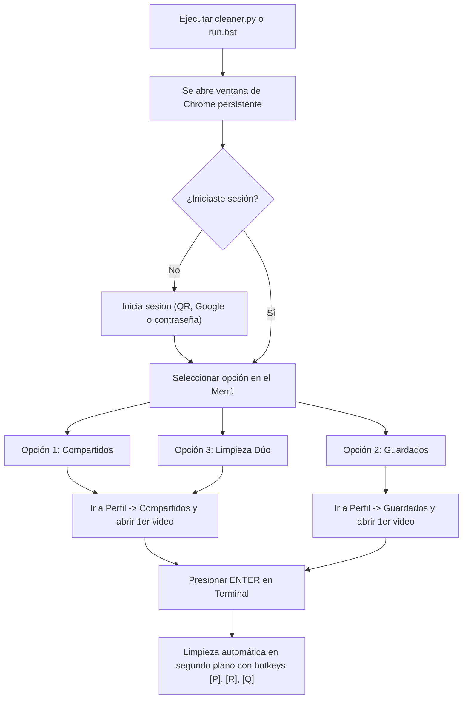

# ⚡ TikTok Auto Cleaner Pro (Terminal Edition)

> Automatización segura y moderna en Python para limpiar masivamente publicaciones **COMPARTIDAS (Reposts)** y videos **GUARDADOS (Favoritos / Bookmarks)** en TikTok Web sin perder tu sesión y trabajando en segundo plano.

[](https://www.python.org/)
[](https://www.selenium.dev/)
[](https://www.microsoft.com/)
[](LICENSE)

---

## 🌟 Características Principales

- 🟡 **Eliminador de Compartidos (Reposts):** Detecta con exactitud si un video sigue compartido (`Remove repost` / `Eliminar la publicación compartida`) y lo desmarca con un solo clic físico simulado.
- 🔖 **Eliminador de Guardados (Favoritos):** Detecta el botón de bookmark/favorito activo (resaltado en dorado/amarillo o etiqueta de remover favorito) y lo retira automáticamente.
- 🚀 **Modo Limpieza Dúo:** Ejecuta la limpieza de Compartidos primero y luego continúa con Guardados en una sola sesión guiada.
- 🪟 **Persistencia de Sesión Local:** Utiliza una ventana de Google Chrome dedicada (`chrome_session`) conectada por el puerto de depuración `9222`. Inicias sesión una sola vez (QR, Google, usuario) y tu sesión queda guardada localmente para siempre.
- 🖥️ **Trabajo Real en Segundo Plano:** El script inyecta protecciones contra la congelación de pestañas inactivas (`Page Visibility API keepalive` y flags de Chrome como `--disable-backgrounding-occluded-windows`), permitiéndote usar otras ventanas o trabajar en tu PC mientras el bot limpia en el fondo.
- 🛡️ **Protección Anti-Rate Limit y Anti-403:**
  - Cadencia humana aleatoria (1.8s a 2.8s entre videos).
  - Pausas automáticas de enfriamiento (cooldown) cada 30 videos eliminados.
  - Detección inteligente de 3 rechazos consecutivos con freno de seguridad temporal.
- 🎮 **Teclas de Control en Vivo en la Consola:**
  - `[P]` : Pausar / Reanudar la limpieza en cualquier momento.
  - `[R]` : Re-escanear la pestaña de TikTok y reiniciar el ciclo sobre el video actual.
  - `[Q]` : Salir del programa inmediatamente (dejando tu navegador Chrome intacto).

---

## 🔒 Privacidad y Seguridad Garantizada

> [!IMPORTANT]
> **Tus credenciales y datos de sesión NUNCA se suben a GitHub ni a servidores externos.**
> La carpeta `chrome_session/` está estrictamente excluida en el archivo `.gitignore`. Toda la información de inicio de sesión, cookies y almacenamiento local reside 100% en tu propia máquina.

---

## 📋 Requisitos Previos

1. **Sistema Operativo:** Windows 10 u 11.
2. **Google Chrome** instalado.
3. **Python 3.8 o superior** instalado con la opción *"Add Python to PATH"* habilitada.

---

## 🚀 Instalación y Puesta en Marcha

### 1. Clonar el repositorio
```bash
git clone https://github.com/josezambranol/tiktok-cleaner.git
cd tiktok-cleaner
```

### 2. Instalar dependencias
```bash
pip install -r requirements.txt
```

### 3. Ejecutar el script

**Opción A (Fácil):**
Haz doble clic sobre el archivo:
```text
run.bat
```

**Opción B (Desde la Terminal / PowerShell):**
```bash
python cleaner.py
```

---

## 📖 Guía Paso a Paso de Uso



1. **Abrir el programa:** Ejecuta `python cleaner.py`. Si Chrome no está abierto en modo depuración, el script lo lanzará automáticamente.
2. **Inicio de sesión (solo la primera vez):** Si es tu primera vez, inicia sesión en TikTok en esa ventana de Chrome. Tu sesión quedará guardada de forma permanente en tu carpeta local.
3. **Elegir modo:**
   - Presiona `1` para **Compartidos (Reposts)**.
   - Presiona `2` para **Guardados (Favoritos)**.
   - Presiona `3` para **Limpieza Dúo**.
4. **Abrir el primer video:** En la ventana de Chrome:
   - Para Compartidos: Ve a tu **Perfil** $\rightarrow$ Pestaña **Compartidos** $\rightarrow$ Haz clic en el **primer video** para que se abra en grande.
   - Para Guardados: Ve a tu **Perfil** $\rightarrow$ Pestaña **Guardados** $\rightarrow$ Haz clic en el **primer video**.
5. **Comenzar:** Regresa a la consola y pulsa **ENTER**.
6. **Disfruta:** Puedes minimizar la consola o poner otras ventanas encima de Chrome; el script seguirá limpiando con ritmo seguro y mostrando el contador en pantalla.

---

## ⌨️ Comandos Interactivos en Tiempo Real

Durante la ejecución, pulsa cualquiera de estas teclas directamente sobre la consola (sin necesidad de presionar Enter):

| Tecla | Acción | Descripción |
| :---: | :---: | :--- |
| **`P`** | **Pausar / Reanudar** | Pone en pausa inmediata el ciclo para que puedas acomodar videos o verificar en Chrome. |
| **`R`** | **Re-escanear** | Vuelve a examinar las pestañas abiertas y reanuda el bot sobre el video actual. |
| **`Q`** | **Salir** | Detiene el script de inmediato sin cerrar tu ventana de Chrome. |

---

## 🛠️ Estructura del Proyecto

```text
tiktok-cleaner/
├── cleaner.py          # Script principal de automatización por consola
├── run.bat             # Lanzador rápido con verificación de dependencias
├── requirements.txt    # Librerías de Python requeridas (Selenium, WebDriver-Manager)
├── .gitignore          # Exclusión crítica de carpetas de sesión y temporales
├── LICENSE             # Licencia MIT de código abierto
└── README.md           # Documentación completa
```

---

## 💡 Consejos Útiles y Solución de Problemas

- **¿No te aparece la pestaña Compartidos en tu perfil?**
  - Es un comportamiento conocido de TikTok Web cuando tienes mucho tiempo sin compartir. Dale a compartir a un video cualquiera de tu feed de inicio y la pestaña volverá a aparecer al instante con todos tus reposts antiguos.
- **¿TikTok muestra error HTTP 403 o rate limit temporal?**
  - TikTok protege sus servidores con frenos temporales si detecta demasiadas acciones consecutivas. Si esto sucede, el script pausará automáticamente por 45 segundos. Deja que descanse y reanuda con `[P]`.
- **Trabajo en Segundo Plano:**
  - No minimices la ventana de Chrome (déjala en su tamaño normal). Si quieres ver videos de YouTube, trabajar o estudiar, simplemente abre otra ventana de navegador encima.

---

## 📄 Licencia

Este proyecto está bajo la Licencia [MIT](LICENSE) - siéntete libre de utilizarlo y adaptarlo a tus necesidades.

> **Descargo de responsabilidad:** Este proyecto es una herramienta de automatización para uso personal y educativo. No está afiliado ni respaldado por TikTok o ByteDance Ltd.
